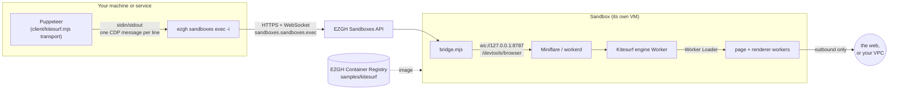

# Kitesurf on EZGH Sandboxes

A sample architecture and deployment for running [Kitesurf](https://github.com/cloudflare/kitesurf),
Cloudflare's experimental agent browser engine, in [EZGH Sandboxes](https://docs.ezghcloud.com/sandboxes/),
and driving it with Puppeteer from anywhere.

Kitesurf is a Cloudflare Worker that parses HTML, applies CSS, runs page JavaScript and renders
screenshots without Chrome, and speaks the Chrome DevTools Protocol (CDP). Here it runs on
[workerd](https://github.com/cloudflare/workerd), the open-source Workers runtime, inside a sandbox:
each browser gets its own virtual machine, suspends when idle, and resumes on the next connection.

## Architecture



- **The image** (`Dockerfile`) builds Kitesurf from a pinned commit with its own Bazel build
  (`//packages/engine:dist`: the Rust core compiled to WebAssembly plus the Worker bundle), and
  serves that bundle with [Miniflare](https://www.npmjs.com/package/miniflare), which runs workerd
  and provides the Worker Loader binding Kitesurf starts each page in. It's the same way Kitesurf's
  own test runner serves the engine.
- **The engine listens on 127.0.0.1 only.** A sandbox accepts no inbound connections, so the one way
  in is a command run through the Sandboxes API. `sandbox/bridge.mjs` is that command: it opens the
  engine's CDP WebSocket and carries its messages over stdin and stdout.
- **The client** (`client/kitesurf.mjs`) gives Puppeteer a transport that runs
  `ezgh sandboxes exec -i <sandbox> -- node /app/bridge.mjs` and speaks CDP over it. The CLI handles
  sign-in and resumes a suspended sandbox before the command runs.
- **CI** (`.github/workflows/image.yml`) builds the image, smoke-tests it with a screenshot through
  the bridge, and on `main` pushes it to EZGH Container Registry as a bot, using the job's GitHub
  OIDC token through [setup-ezgh](https://github.com/ezgamehost/setup-ezgh): no stored API key.

### Authentication

Kitesurf has no authentication of its own and must never be reachable without some in front of it.
In a sandbox nothing can connect to it: to drive the browser, a caller needs
`sandboxes.sandboxes.exec` on that sandbox, checked on every connection. Use EZGH IAM policies to
choose who can.

### Lifecycle

| | |
| --- | --- |
| Start | The sandbox's start command (`/app/start.sh`) runs the engine. Its log is `/tmp/kitesurf.log`. |
| Idle | With no open connection for `--idle-seconds`, the sandbox suspends, keeping its memory. |
| Next connection | Resumes it; the engine carries on where it was. The bridge waits up to 60 s for the engine. |
| One per agent | Give each agent or job its own sandbox: separate VMs, cookies and page state. |
| Page limits | Each page gets 20 s of CPU (`KITESURF_PAGE_CPU_MS_CAP`, in ms). Set `--env KITESURF_PAGE_CPU_MS_CAP=…` or `KITESURF_PAGE_WALL_MS_CAP` at create to change it. |
| Stuck engine | One engine serves every connection in the sandbox. If it stops answering, `ezgh sandboxes stop kitesurf --wait && ezgh sandboxes start kitesurf --wait` restarts it. |

Pages are untrusted code. They run inside the sandbox's VM, and their requests leave through the
sandbox's outbound network. A sandbox created in a VPC subnet (`--subnet`) reaches that VPC, so
pages could too: keep browsers that load arbitrary sites out of VPCs that hold private services.

## Deploy

You need the [`ezgh` CLI](https://docs.ezghcloud.com/cli/) v0.66.1 or later, signed in, and
`SandboxesFullAccess` in the project.

1. **Get the image.** Use one built by this repository's CI, or build and push your own:

   ```sh
   ezgh registry login
   docker build --platform linux/amd64 -t <id>.registry.ezghcloud.com/samples/kitesurf:latest .
   docker push <id>.registry.ezghcloud.com/samples/kitesurf:latest
   ```

   `ezgh registry get` shows your project's registry host. The first build compiles Kitesurf's
   Rust core and takes a while.

2. **Create the sandbox.**

   ```sh
   ezgh sandboxes create <id>.registry.ezghcloud.com/samples/kitesurf:latest \
     --name kitesurf --vcpus 2 --memory-mib 2048 --idle-seconds 900 --wait -- /app/start.sh
   ```

3. **Take a screenshot** through it.

   ```sh
   cd client && npm ci
   node screenshot.mjs kitesurf https://example.com/ page.png
   ```

To use it from your own code:

```js
import { connect, sandboxBridge } from "./kitesurf.mjs";

const browser = await connect(sandboxBridge("kitesurf"));
const page = await browser.newPage();
await page.goto("https://news.ycombinator.com/");
console.log(await page.$$eval(".titleline > a", (links) => links.map((a) => a.textContent)));
await browser.disconnect();
```

Code running in the same sandbox, such as an agent you copy in with `ezgh sandboxes cp`, can
connect to `ws://127.0.0.1:8787/devtools/browser` directly.

When you're done: `ezgh sandboxes delete kitesurf --yes`.

## Build and push from your own fork

CI pushes when the repository variables `EZGH_ORG`, `EZGH_BOT` and `EZGH_REGISTRY` are set. Once,
with an account that can manage IAM:

```sh
ezgh projects create kitesurf
ezgh iam bots create kitesurf-image-ci

# Only push and pull, only in that project:
cat > push.json <<'EOF'
{"statements":[{"effect":"allow",
  "actions":["registry.repositories.get","registry.repositories.create","registry.images.get",
             "registry.images.pull","registry.images.push"],
  "resources":["ezgh:us-west-1:<org>:<project>:*"]}]}
EOF
ezgh iam policies create kitesurf-image-push --document @push.json
ezgh iam policies attach kitesurf-image-push --bot kitesurf-image-ci

# Only this repository's main branch may act as the bot:
ezgh iam oidc-providers create github --issuer https://token.actions.githubusercontent.com  # once per organization
ezgh iam bots oidc-trust add kitesurf-image-ci --provider github \
  --subject 'repo:*:ref:refs/heads/main' --claim repository_id=$(gh api repos/<owner>/<repo> --jq .id)

gh variable set EZGH_ORG -b <org>
gh variable set EZGH_BOT -b <bot>
gh variable set EZGH_REGISTRY -b "$(ezgh registry get --project kitesurf -o json | jq -r .host)"
```

## Versions

| | |
| --- | --- |
| Kitesurf | `KITESURF_REF` in the `Dockerfile` |
| Miniflare | `sandbox/package.json`, kept on the version Kitesurf's `pnpm-lock.yaml` pins at that commit |
| Puppeteer | `client/package.json` |

Kitesurf is experimental and implements a subset of CDP; see its README for what works.

## License

Apache 2.0, the same as Kitesurf. `sandbox/serve.mjs` is adapted from Kitesurf's
`scripts/wpt-engine.mjs`. The image includes Kitesurf's `LICENSE` and `NOTICE`.
